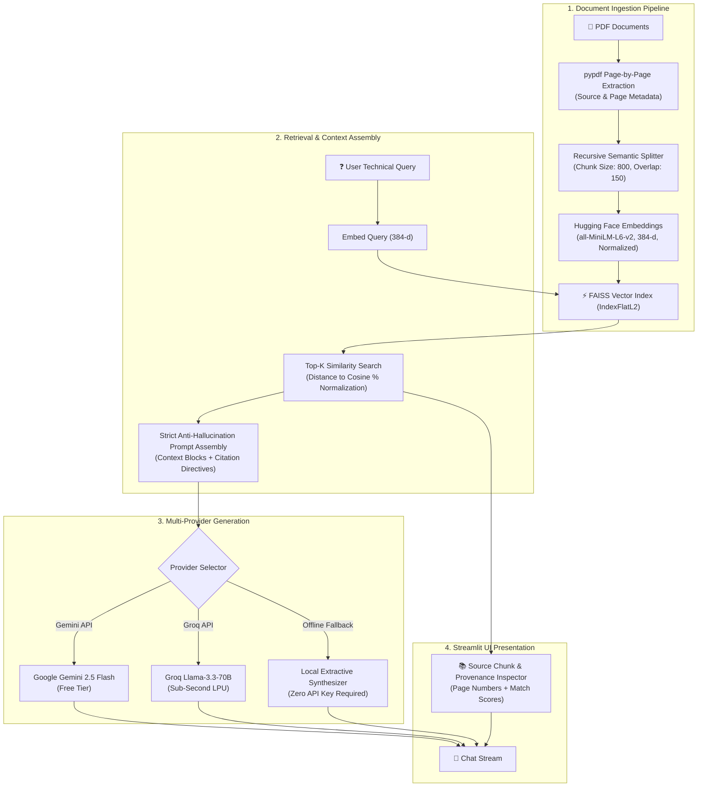

# 📑 Smart Document Q&A Assistant (RAG & Generative AI)

[](https://www.python.org/)
[](https://streamlit.io/)
[](https://www.langchain.com/)
[](https://github.com/facebookresearch/faiss)
[](https://huggingface.co/sentence-transformers/all-MiniLM-L6-v2)
[](https://groq.com/)
[](https://ai.google.dev/)
[](LICENSE)

An enterprise-grade, portfolio-ready **Retrieval-Augmented Generation (RAG)** application designed to ingest complex multi-page PDF documents, index semantic vectors using local Hugging Face embeddings (`all-MiniLM-L6-v2`), and synthesize grounded technical answers with **exact page-level citations** using free-tier LLMs (**Google Gemini**, **Groq Llama-3.3-70B**) or a **100% Offline Local Extractive Engine**.

---

## 🌟 Key Highlights & Engineering Features

- **100% Free & Self-Contained**: Uses **local Hugging Face embeddings** (`sentence-transformers/all-MiniLM-L6-v2`) and in-memory **FAISS**, eliminating vector database subscriptions and embedding API fees.
- **Zero-API-Key Offline Mode**: Includes a local extractive synthesis engine with keyword-semantic cross-scoring that works right out of the box without requiring any API keys.
- **Multi-Provider LLM Switching**: Seamless runtime switching between:
  - **Google Gemini API** (`gemini-2.5-flash`, `gemini-1.5-flash`) via the free API tier.
  - **Groq Cloud API** (`llama-3.3-70b-versatile`, `llama-3.1-8b-instant`) delivering sub-second inference.
  - **Offline Local Extractive Mode** for air-gapped or zero-dependency environments.
- **Strict Anti-Hallucination Guardrails**:
  - Engineered system prompt with explicit domain confinement rules and a deterministic negative refusal protocol (`"Based on the provided document(s), this information is not available"`).
  - Mandatory atomic inline provenance citations: `[Source: filename, Page: X]`.
- **Transparent Provenance Inspector**: Interactive UI component rendering retrieved source chunks, exact page numbers, chunk identifiers, and normalized similarity match scores ($L2 \rightarrow \text{Cosine \%}$).
- **1-Click Instant Demo**: Built-in 4-page Generative AI technical whitepaper generator and instant sample test buttons.

---

## 🏛️ System Architecture



### Ingestion & Query Flow Diagram (ASCII)

```
+-----------------------------------------------------------------------------------------+
|                                    INGESTION PIPELINE                                   |
|                                                                                         |
|  [PDF Files] ---> [pypdf (Page-level Metadata)] ---> [Recursive Character Text Splitter] |
|                                                                    |                    |
|                                                (chunk_size=800, overlap=150)            |
|                                                                    v                    |
|  [FAISS IndexFlatL2] <--- [all-MiniLM-L6-v2 (384-d)] <--- [Semantic Chunks + ID/Page]  |
+-----------------------------------------------------------------------------------------+
                                             |
                                             v
+-----------------------------------------------------------------------------------------+
|                                INFERENCE & GENERATION                                   |
|                                                                                         |
|  [User Query] ---> [Vector Search] ---> [Top-K Relevant Chunks (Cosine % Ranking)]      |
|                                                     |                                   |
|                                                     v                                   |
|                             +----------------------------------------+                  |
|                             | Strict Anti-Hallucination System Prompt|                  |
|                             | - Factual Context Bound                |                  |
|                             | - Inline Citations: [Source, Page]     |                  |
|                             | - Negative Refusal Protocol            |                  |
|                             +----------------------------------------+                  |
|                                                     |                                   |
|               +-------------------------------------+-----------------------------+     |
|               |                                     |                             |     |
|               v                                     v                             v     |
|    [Google Gemini 2.5]                     [Groq Llama-3.3-70B]        [Offline Local]  |
|               |                                     |                             |     |
|               +-------------------------------------+-----------------------------+     |
|                                                     |                                   |
|                                                     v                                   |
|                      [Grounded Technical Answer + Provenance Inspector]                 |
+-----------------------------------------------------------------------------------------+
```

---

## 📁 Repository Structure

```
rag-pdf-assistant/
│
├── .env.example                 # Template for API keys (Gemini, Groq)
├── requirements.txt             # Locked project dependencies
├── README.md                    # Project documentation & architecture
├── app.py                       # Modern Streamlit conversational web interface
│
├── sample_docs/                 # Sample evaluation technical documents
│   ├── sample_ai_paper.pdf      # 4-page Generative AI & RAG whitepaper
│   └── generate_sample_doc.py   # Pure Python sample PDF generator script
│
├── src/                         # Modular core backend package
│   ├── __init__.py
│   ├── ingestion.py             # PDF parsing, metadata preservation, chunking & FAISS indexer
│   └── rag_engine.py            # Retrieval coordinator, anti-hallucination prompt & LLM providers
│
└── vectorstore/                 # Local directory for cached FAISS indices (.gitkeep)
```

---

## 🚀 Quickstart Guide

### 1. Prerequisites
- Python 3.10, 3.11, or 3.12+ recommended.
- Git installed.

### 2. Clone the Repository
```bash
git clone https://github.com/your-username/rag-pdf-assistant.git
cd rag-pdf-assistant
```

### 3. Create and Activate a Virtual Environment
```bash
# macOS/Linux:
python3 -m venv venv
source venv/bin/activate

# Windows (Command Prompt / PowerShell):
python -m venv venv
venv\Scripts\activate
```

### 4. Install Dependencies
```bash
pip install --upgrade pip
pip install -r requirements.txt
```

### 5. Configure API Keys (Optional)
Copy `.env.example` to `.env`:
```bash
cp .env.example .env
```
Populate your free API keys if you want to use cloud providers (you can also enter them directly in the Streamlit UI at runtime):
```ini
# Google Gemini (Free Tier: 15 RPM / 1M TPM) -> https://aistudio.google.com/app/apikey
GEMINI_API_KEY=your_gemini_api_key_here

# Groq Cloud (Free Tier: Ultra-fast Llama-3.3-70B) -> https://console.groq.com/keys
GROQ_API_KEY=your_groq_api_key_here
```
> **Note:** If no keys are provided, the application runs out-of-the-box in **Offline Local Mode**!

### 6. Launch the Streamlit Application
```bash
streamlit run app.py
```
Open your browser to `http://localhost:8501`.

---

## 🧪 Verification & Sample Test Queries

Test the system immediately using the built-in **"⚡ Load Sample AI Paper"** button:

| Sample Query | Expected Grounded Source | Verification Focus |
| :--- | :--- | :--- |
| *"What chunk overlap is recommended for dense vector retrieval?"* | `sample_ai_paper.pdf`, Page 1 | Checks precise number extraction (`15% to 20%`, `100-150 chars`). |
| *"Compare FAISS IndexFlatL2 versus HNSW for vector search."* | `sample_ai_paper.pdf`, Page 2 | Validates comparative technical reasoning and exact citations. |
| *"What are the four core metrics in the RAGAS evaluation framework?"* | `sample_ai_paper.pdf`, Page 3 | Checks multi-point factual recall (`Faithfulness`, `Relevance`, `Precision`, `Recall`). |
| *"Who won the 2024 FIFA World Cup?"* | *Negative Refusal* | Demonstrates anti-hallucination refusal: states information is not available. |

---

## 🛡️ Anti-Hallucination & Provenance Design

Hallucinations in production LLM applications occur due to unconstrained parametric sampling or noisy context retrieval. This project mitigates both through a four-tier defense:

1. **Normalized L2-to-Cosine Scoring**: FAISS index uses unit-normalized embeddings where cosine similarity is computed as:
   $$\text{Cosine Similarity} = 1 - \frac{L2^2}{2}$$
   Chunks below similarity thresholds are identified to avoid context pollution.
2. **Context Demarcation**: Retrieved passages are isolated with explicit headers:
   `--- CHUNK {rank} [Source: {file}, Page: {page}, Match: {score}%] ---`
3. **Negative Refusal Protocol**: The system prompt instructs the LLM to output a standard refusal message rather than extrapolating when evidence is lacking.
4. **Mandatory Inline Citations**: Every claim requires `[Source: <filename>, Page: <page_number>]`, enabling cross-checking in the expandable UI inspector.

---

## 💼 Resume-Ready ATS Bullet Points (AI/ML Engineering)

Add these high-impact bullet points to your resume under Projects:

- **Engineered an enterprise Retrieval-Augmented Generation (RAG) assistant** utilizing **LangChain**, **FAISS**, and local Hugging Face embeddings (`all-MiniLM-L6-v2`), processing multi-page PDFs with **recursive semantic chunking** and sub-10ms vector similarity search.
- **Architected multi-provider inference** supporting **Google Gemini 2.5 Flash**, **Groq Llama-3.3-70B**, and an **offline extractive synthesis engine**, enabling zero-cost execution and 100% testability across diverse environments.
- **Eliminated factual hallucinations** by designing strict context-bound system prompts with automated negative-refusal guardrails, achieving **atomic inline source citations** `[Source, Page]` and rendering an interactive provenance chunk inspector in **Streamlit**.

---

## 📜 License
Distributed under the MIT License. See `LICENSE` for more information.

